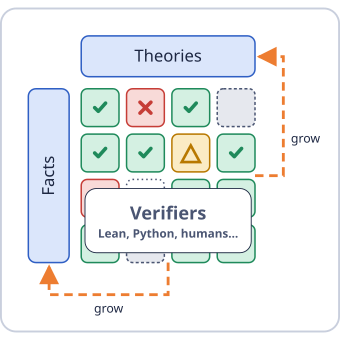
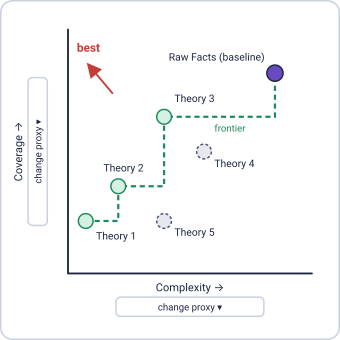

# LingLab

Develop and compare theories in semantics with an AI assistant. No coding needed.

**[Introduction](https://ai-for-linguistics.github.io/linglab/)** · **[Download the kit](https://ai-for-linguistics.github.io/linglab/linglab-beta.zip)**

Bring a question, some papers, or your own judgments. The assistant organizes facts and principles, checks predictions, and builds a dashboard comparing theories. You decide what to add, revise, and trust.

## Start

1. Download and unzip the kit.
2. Give your AI assistant the [launch prompt](PROMPT.md).
3. Keep the chat beside the generated dashboard and reload it after each update.

Use an assistant that can read and write files and run commands. Its usual credits or API costs apply. AI results can be wrong and can vary between runs: check translations and evidence before drawing conclusions.

Claude Code users can also install the playbooks as optional skills; other assistants use the same plain instructions. See the [guide](GUIDE.md).

[Guide](GUIDE.md) · [Worked example](example/) · [Contributing](CONTRIBUTING.md) · [Contributors](AUTHORS.md) · [MIT license](LICENSE)
